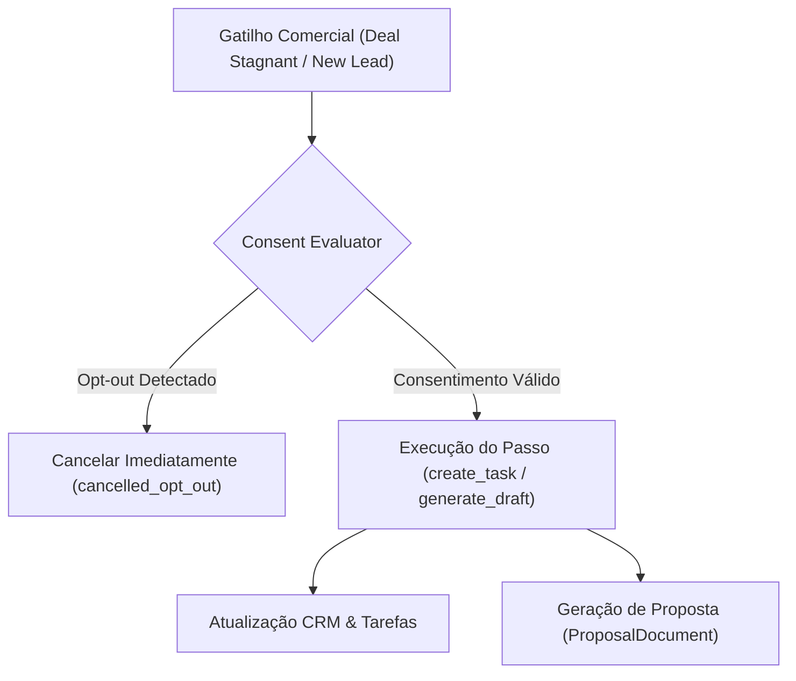

# Arquitetura de Cadências, Consentimento e Propostas (Onda W08)

## 1. Visão Geral

O módulo de automações do Birthub 360 Full Operation opera sob o princípio de comunicação consentida:

## 2. Regras de Conformidade LGPD

- Toda solicitação de descadastramento registrada em `/api/v1/automations/consent` com status `opt_out` tem efeito imediato e cancela execuções pendentes.
- Nenhuma comunicação externa pode ocorrer sem base de consentimento ativa.
