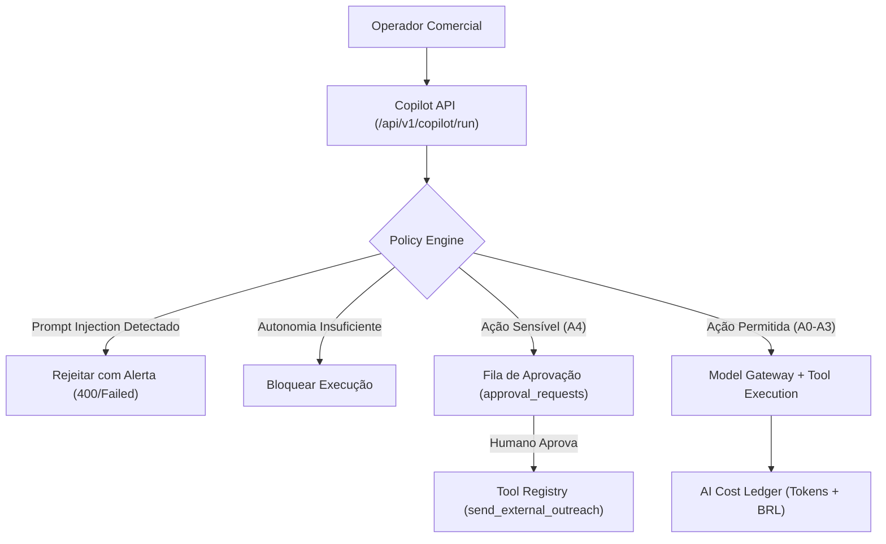

# Arquitetura do Runtime de IA e Governança (Onda W07)

## 1. Visão Geral

O runtime de IA do Birthub 360 Full Operation implementa uma arquitetura em camadas orientada a políticas fail-closed:

## 2. Níveis de Autonomia e Mapeamento de Ferramentas

| Nível | Categoria | Ferramenta Exemplo | Requer Aprovação Humana? |
|---|---|---|---|
| **A0** | Somente recomendar | Explicação de radar / priorização | Não |
| **A1** | Rascunhar | `draft_followup_email` | Não |
| **A2** | Leitura autorizada | `search_crm_context` | Não |
| **A3** | Escrita interna | `create_internal_task` | Não |
| **A4** | Ação sensível externa | `send_external_outreach` | **SIM (Obrigatória)** |

## 3. Segurança e Auditoria

- As execuções são persistidas em `agent_runs` e `tool_executions` protegidas por `FORCE ROW LEVEL SECURITY`.
- Custos são consolidados na tabela `ai_cost_ledger`.
