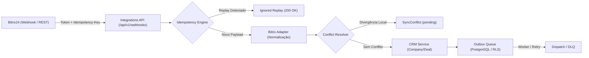

# Arquitetura de Integrações, Outbox e Reconciliação (Onda W05)

## 1. Visão Geral

A camada de integrações do Birthub 360 Full Operation é responsável por mediar o fluxo de informações entre o CRM nativo e sistemas externos como Bitrix24, Apollo, bases públicas de CNPJ e webhooks customizados.

## 2. Componentes Principais

### 2.1 `@birthub/integration-kit`
- **`bitrix24.adapter.ts`**: Normaliza os campos do Bitrix24 (`OPPORTUNITY`, `STAGE_ID`, `ASSIGNED_BY_ID`) para o formato do Birthub, com estágios mapeados para o funil canônico (`lead`, `qualification`, `meeting_scheduled`, `proposal_sent`, `negotiation`, `closed_won`, `closed_lost`).
- **`idempotency.ts`**: Impede que disparos repetidos de webhooks externos gerem entidades em duplicidade.
- **`conflict.ts`**: Compara valores locais com os recebidos externamente para evitar perda acidental de dados atualizados pelo time comercial.
- **`outbox.ts`**: Fila de eventos transacionais resiliente com suporte a retentativas e Dead-Letter Queue.

### 2.2 Migrações e Isolamento RLS
A migração `infra/local/migrations/003_integrations_outbox.sql` cria:
- `external_integrations`: Configuração por organização com constraint `UNIQUE (tenant_id, provider)`.
- `external_identities`: Mapeamento bi-direcional de identificadores.
- `outbox_events`: Eventos transacionais com `status ('pending', 'processed', 'failed', 'dead_letter')`.
- `sync_cursors`: Posição atual de leitura incremental por tenant/provedor/entidade.
- `sync_conflicts`: Conflitos aguardando intervenção manual ou por política.

Todas as tabelas contam com `FORCE ROW LEVEL SECURITY` e políticas `fail-closed` amarradas a `current_tenant_id()`.
