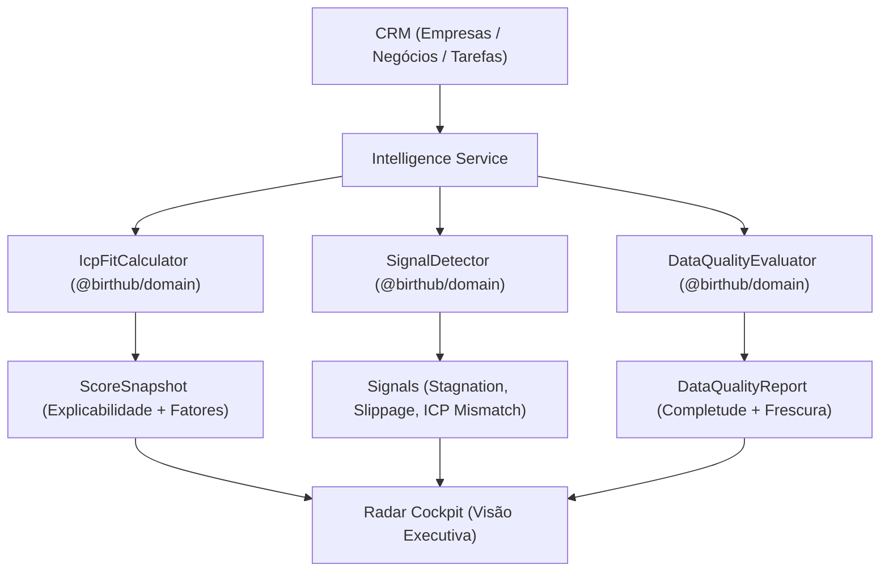

# Modelo de Inteligência Comercial e Radar de Sinais (Onda W06)

## 1. Visão Geral

A camada de inteligência do Birthub 360 Full Operation traduz dados do CRM e de integrações em decisões comerciais práticas e auditáveis:

## 2. Critérios de ICP Fit e Faixas de Classificação

| Faixa de Score | Classificação | Ação Recomendada |
|---|---|---|
| 85 a 100 | **Grade A** | Atendimento prioritário por Account Executive |
| 70 a 84 | **Grade B** | Qualificação padrão em cadência regular |
| 50 a 69 | **Grade C** | Qualificação inbound com playbook digital |
| 0 a 49 | **Grade D** | Autoatendimento ou baixa prioridade |
| *Sem Evidência* | **unknown** | Disparo de enriquecimento prévio antes da abordagem |

## 3. Regras Determinísticas do Radar

1. **`stagnation_risk`:** Oportunidade em estágio ativo há mais de 14 dias sem atividades registradas.
2. **`deal_slippage`:** Oportunidade com valor >= R$ 50.000 em estágios finais (`proposal_sent`, `negotiation`) sem nenhuma tarefa pendente.
3. **`icp_mismatch`:** Negócio avançado com empresa classificada como ICP D ou Unknown.
