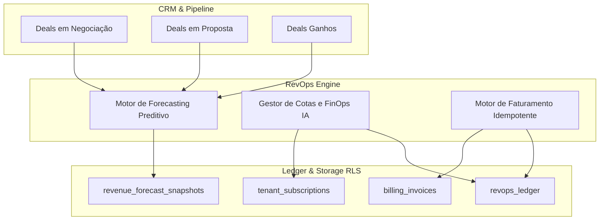

# Arquitetura de RevOps, Forecasting e Faturamento Idempotente (W09)

## 1. Visão Geral

O módulo de RevOps unifica a inteligência comercial, gestão de planos e billing transacional sob rígidas garantias de isolamento multi-tenant e idempotência.



## 2. Modelagem de Dados e RLS Fail-Closed

A migração `007_revops_and_monetization.sql` estabelece as tabelas fundamentais:
- `tenant_subscriptions`: Plano ativo (`starter`, `growth`, `enterprise`), ciclo vigente e cotas de IA em BRL.
- `billing_invoices`: Faturas comerciais com `idempotency_key` e índice único por período e tenant.
- `billing_invoice_items`: Discriminação detalhada de assinaturas e consumos excedentes.
- `revops_ledger`: Livro-razão contábil e imutável para FinOps e auditoria.
- `revenue_forecast_snapshots`: Histórico de previsões com breakdown por estágio de vendas.

Todas as tabelas são protegidas com:
```sql
ALTER TABLE billing_invoices ENABLE ROW LEVEL SECURITY;
ALTER TABLE billing_invoices FORCE ROW LEVEL SECURITY;
CREATE POLICY tenant_isolation_billing_invoices ON billing_invoices
  USING (tenant_id = current_tenant_id())
  WITH CHECK (tenant_id = current_tenant_id());
```

## 3. Mecanismo de Idempotência no Faturamento

O fluxo de emissão de faturas implementa o padrão de token de idempotência:
1. O cliente fornece um cabeçalho `Idempotency-Key` ou parâmetro no body.
2. A API consulta o índice em memória/banco pela chave.
3. Se a chave já existir:
   - Valida se o `tenant_id` é o mesmo. Se for diferente, dispara `CrossTenantViolationError` (HTTP 403).
   - Retorna a fatura com `200 OK` e `X-Idempotent-Replay: true`.
4. Se a chave for inédita:
   - Gera fatura única, persiste os itens, insere registro no ledger e retorna `201 Created`.
