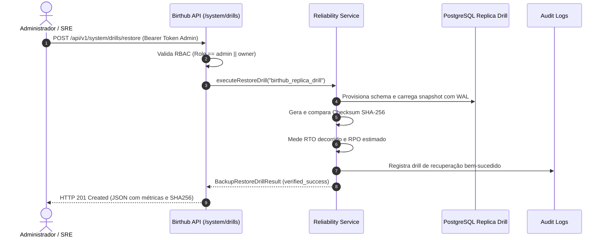

# Runbook de Disaster Recovery (DR) e Restore Drill Verificado

## 1. Visão Geral e Métricas Alvo

O Birthub 360 Full Operation adota uma política de tolerância zero a perda de integridade contábil e de CRM.

- **RTO Alvo (Recovery Time Objective):** $< 15\text{ minutos}$ (900 segundos).
- **RPO Alvo (Recovery Point Objective):** $< 5\text{ minutos}$ (via WAL streaming e snapshots periódicos).
- **Mecanismo de Validação:** Verificação criptográfica SHA-256 e contagem cruzada de registros.

---

## 2. Fluxo Operacional do Restore Drill



---

## 3. Procedimento Manual de Emergência (Cold Restore)

Caso o cluster primário sofra falha catastrófica:

1. **Ativação da Réplica Standby:**
   ```bash
   pg_ctl promote -D /var/lib/postgresql/data
   ```
2. **Aplicação do Último WAL Archive:**
   ```bash
   restore_command = 'cp /mnt/wal_archive/%f %p'
   ```
3. **Disparo da Verificação de Integridade:**
   ```bash
   curl -X POST https://api.birthub360.com/api/v1/system/drills/restore \
     -H "Authorization: Bearer $SUPERADMIN_TOKEN"
   ```
4. **Verificação de Health & Readiness:**
   ```bash
   curl https://api.birthub360.com/health/ready
   # Esperado: {"status":"ready","checks":{"database":true,"rlsEnforcement":true,...}}
   ```
